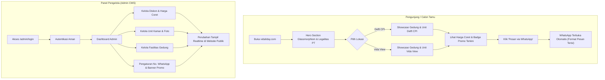
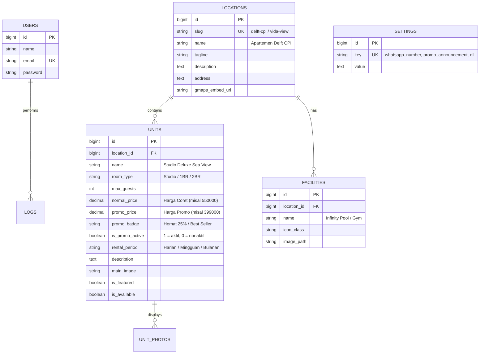

# Master Blueprint & Rencana Pengembangan: VIDALIDAY (vidaliday.com)
*Revisi 2.0: Pure Tailwind CSS (Glassmorphism Theme) & Admin CMS Panel*

Dokumen ini disusun sebagai acuan teknis dan operasional untuk pengembangan website resmi **VIDALIDAY**, platform katalog dan reservasi sewa apartemen harian, mingguan, dan bulanan di Makassar.

---

## 1. Product Requirements Document (PRD)

### 1.1 Visi & Tujuan Produk
- **Visi**: Menjadi platform katalog digital sewa apartemen mewah dan terpercaya di Makassar dengan estetika modern masa depan.
- **Tujuan Utama**:
  1. **Konversi Cepat (*Direct WhatsApp Booking*)**: Tamu dapat memilih unit idaman dan langsung memesan ke WhatsApp Admin dengan draf pesan otomatis.
  2. **Kredibilitas Resmi**: Menampilkan legalitas hukum **PT PERDANA MEGA TRANS** secara elegan guna membangun rasa aman 100%.
  3. **Pengelolaan Konten Dinamis (Admin CMS)**: Admin dapat login untuk mengelola harga kamar, harga coret/promo, diskon spesial, fasilitas, dan kontak WhatsApp tanpa menyentuh kode.
  4. **Visual Mewah & Modern (*Glassmorphism*)**: Tampilan visual kelas atas dengan efek kaca transparan (*frosted glass*) yang bersih dan futuristik.
  5. **SEO Lokal Makassar**: Terindeks optimal untuk kata kunci *"sewa apartemen makassar"*, *"apartemen delft cpi"*, dan *"apartemen vida view"*.

---

### 1.2 Target Pengguna (User Personas)
1. **Wisatawan & Pelancong**: Mencari apartemen tepi laut / ikonik (Delft CPI) dengan fasilitas kolam renang infinity view.
2. **Pebisnis & Karyawan Dinas**: Mencari hunian strategis di pusat kota (Vida View Panakkukang) untuk sewa harian, mingguan, atau bulanan.
3. **Admin VIDALIDAY (Internal)**: Pengelola yang membutuhkan dasbor praktis dan aman untuk mengupdate promo, harga coret, ketersediaan unit, dan foto kamar secara berkala.

---

### 1.3 Alur Pengguna (User Journey)

---

### 1.4 Kebutuhan Fungsional (Functional Requirements)

#### A. Sisi Publik (Guest Facing)
| Kode | Modul | Deskripsi |
|---|---|---|
| **PUB-01** | **Hero Glassmorphic** | Banner utama elegan dengan kartu kaca melayang (*frosted glass*), legalitas PT Perdana Mega Trans, dan tagline. |
| **PUB-02** | **Location Switcher** | Pemilih lokasi instan antara **Apartemen Delft CPI** dan **Apartemen Vida View**. |
| **PUB-03** | **Showcase Fasilitas** | Tampilan kartu fasilitas gedung (kolam renang, gym, sky garden, security 24h) dengan visual glassmorphism. |
| **PUB-04** | **Katalog Kamar & Promo Dinamis** | Menampilkan kartu unit dengan foto interior, tipe kamar, kapasitas, fasilitas, harga normal (coret), dan harga diskon hasil inputan Admin. |
| **PUB-05** | **WhatsApp Click-to-Chat Generator** | Tombol CTA hijau WhatsApp dengan draf pesan otomatis berisi unit dan harga yang dipilih. |
| **PUB-06** | **Floating Mobile WhatsApp Bar** | Akses cepat di layar smartphone agar konversi reservasi selalu dalam jangkauan satu klik. |
| **PUB-07** | **Peta & Jarak Populer** | Estimasi jarak tempuh ke Pantai Losari, CPI, Mall Panakkukang, Rumah Sakit, dan Bandara. |

#### B. Sisi Admin (Admin Dashboard)
| Kode | Modul | Deskripsi |
|---|---|---|
| **ADM-01** | **Autentikasi Admin** | Halaman login aman (`/admin/login`), session guard, fitur ganti password. |
| **ADM-02** | **Kelola Unit & Kamar** | Tambah, ubah, hapus unit kamar (pilihan lokasi, tipe kamar, deskripsi, foto utama/galeri, fasilitas). |
| **ADM-03** | **Kelola Harga & Diskon** | Atur harga normal, harga promo/diskon, label diskon (misal: "Promo Liburan -25%", "Flash Deal"), dan status aktif promo. |
| **ADM-04** | **Kelola Fasilitas Gedung** | Atur daftar fasilitas untuk masing-masing gedung (Delft CPI / Vida View) beserta ikon dan foto. |
| **ADM-05** | **Pengaturan Kontak & Banner** | Ubah nomor WhatsApp admin tujuan, template pesan default, dan running text / banner promo atas website. |

---

## 2. System & Technical Architecture

### 2.1 Stack Teknologi
- **Backend Framework**: Laravel 11.x (PHP 8.2+)
- **Database**: MySQL (didukung penuh oleh Laragon di environment lokal)
- **CSS Engine**: Tailwind CSS murni (menggunakan utility `backdrop-blur`, gradasi transparan, dan border kaca).
- **Interaktivitas Frontend**: Vanilla JavaScript murni (ringan, performa cepat, tanpa dependensi framework JS tambahan seperti Alpine.js).
- **Autentikasi**: Laravel Session-based Authentication dengan Middleware `auth`.

---

### 2.2 Skema Database (Database Schema)

---

## 3. Design System: White Glassmorphism Luxury (Aksen Biru Tipis)

### 3.1 Konsep Visual (The White Frosted Glass Aesthetic)
Tema visual menggabungkan **keanggunan perhotelan modern**, **kesegaran estetika serba putih (*clean white frosted glass*)**, dan **aksen biru tipis (*subtle ocean blue*)**:
- **Latar Belakang (Background)**: Kanvas cerah lembut (`bg-slate-50`) dengan pencahayaan ambient orbs halus bernuansa biru langit (`bg-blue-400/10` dan `bg-sky-300/15`).
- **Kartu Kaca (Glass Containers)**:
  - Kelas Tailwind: `bg-white/80 backdrop-blur-xl border border-slate-200/80 shadow-[0_10px_30px_-10px_rgba(30,41,59,0.07)] rounded-2xl`
  - Efek saat melayang (*hover*): `hover:border-blue-300 hover:shadow-[0_20px_35px_-10px_rgba(59,130,246,0.15)] transition-all duration-300`
- **Upload File Gambar (Bukan Link)**:
  - Form upload file langsung: maks 5MB dengan format JPG, JPEG, PNG, HEIC, WEBP.
  - Tersimpan di penyimpanan lokal storage Laravel (`storage/app/public/units`).
- **Sidebar Admin**:
  - Desain modern collapsible (dapat dibuka tutup dengan tombol toggle di desktop dan mobile drawer).

### 3.2 Palet Warna (Color System)
- **Base Background**: `#F8FAFC` (Slate 50) dengan luminous glow orbs.
- **Glass Surface**: `rgba(255, 255, 255, 0.85)` dengan `backdrop-filter: blur(18px)`.
- **Text & Contrast**:
  - Judul Utama: `#0F172A` (Slate 900) font-extrabold.
  - Body Text: `#475569` (Slate 600) untuk keterbacaan tinggi di ponsel dan laptop.
- **Subtle Blue Accent**: `#2563EB` (Blue 600) & `#EFF6FF` (Blue 50 background badge).
- **Strikethrough Price**: `#EF4444` (Rose 500 teks coret normal).
- **WhatsApp Conversion**: `#25D366` / `bg-emerald-500` (Hover: `bg-emerald-600`) dengan teks putih tegas.

---

## 4. Peran Agen / Tim Pengembang

| Peran | Ruang Lingkup Kerja |
|---|---|
| **System & Database Architect** | Migrasi database (locations, units, facilities, settings, users), Seeder awal, Model Eloquent. |
| **Admin Backend Engineer** | Sistem login admin, kontroler CRUD unit, kontroler harga/promo, pengelolaan foto & pengaturan. |
| **Glassmorphism UI Specialist** | Implementasi layout Blade publik dengan utility Tailwind CSS murni berdesain kaca, mobile-responsive, vanilla JS toggles. |
| **SEO & WhatsApp Flow Engineer** | Logika WhatsApp pre-filled link generator, Open Graph meta tags, integrasi tombol mengambang. |

---

## 5. Master To-Do & Roadmap Pelaksanaan

### Fase 1: Setup Awal & Desain Glassmorphism (Frontend)
- [ ] Install & konfigurasikan Tailwind CSS di proyek Laravel (`tailwind.config.js` & `vite.config.js`).
- [ ] Siapkan preset utility Glassmorphism (`glass-card`, `glass-nav`, `backdrop-blur`, glow accents).
- [ ] Buat Master Layout Blade publik (`resources/views/layouts/app.blade.php`).

### Fase 2: Database & Backend Admin (CMS)
- [ ] Buat skema migrasi tabel: `locations`, `facilities`, `units`, `settings`.
- [ ] Buat Seeder data awal (Delft CPI, Vida View, unit kamar awal, fasilitas gedung, akun admin default).
- [ ] Buat modul Autentikasi Admin (`/admin/login`).
- [ ] Buat Master Layout Blade Admin Dashboard (`resources/views/admin/layout.blade.php`).
- [ ] Buat CRUD Unit Kamar & Pengaturan Harga Promo / Harga Coret.
- [ ] Buat Form Pengaturan Umum (Nomor WhatsApp Admin, Banner Promo Teks).

### Fase 3: Halaman Publik & Katalog Interaktif
- [ ] Bangun Hero Section Glassmorphism dengan legalitas resmi **PT PERDANA MEGA TRANS**.
- [ ] Bangun Switcher Lokasi (Delft CPI & Vida View) menggunakan vanilla JS.
- [ ] Tampilkan kartu unit dinamis dari database (lengkap dengan badge diskon & harga coret dari admin).
- [ ] Tampilkan fasilitas gedung masing-masing apartemen.
- [ ] Tampilkan informasi lokasi & jarak tempat wisata populer.

### Fase 4: Integrasi WhatsApp & Finishing
- [ ] Implementasikan generator link WhatsApp otomatis ke nomor yang diatur di Admin.
- [ ] Floating WhatsApp Button untuk pengguna ponsel.
- [ ] Pengujian menyeluruh: login admin, ubah diskon, cek perubahan di halaman depan, dan klik tombol WhatsApp.
